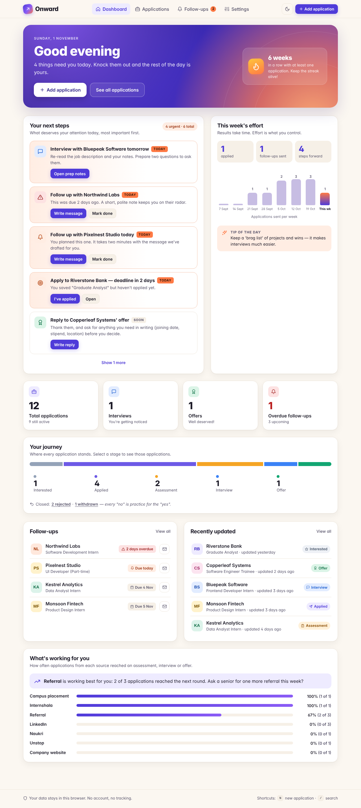
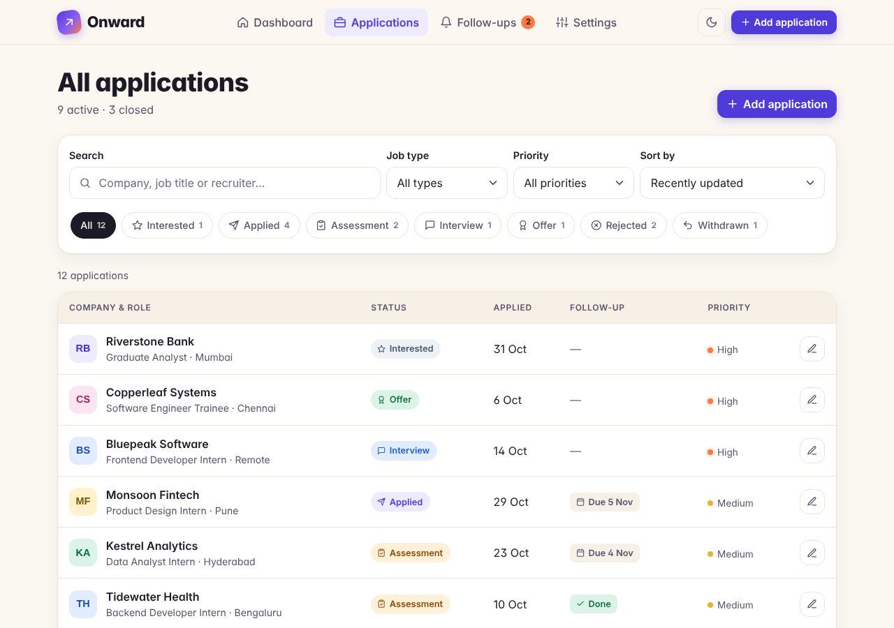
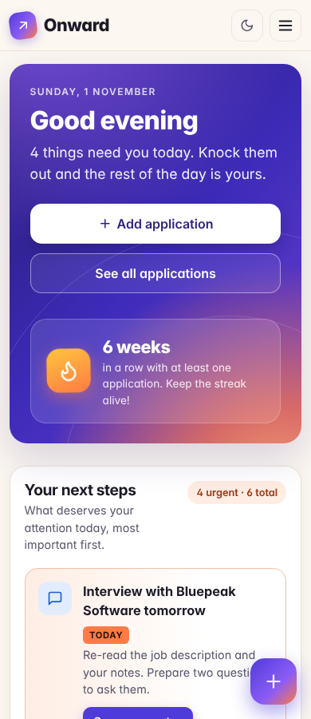
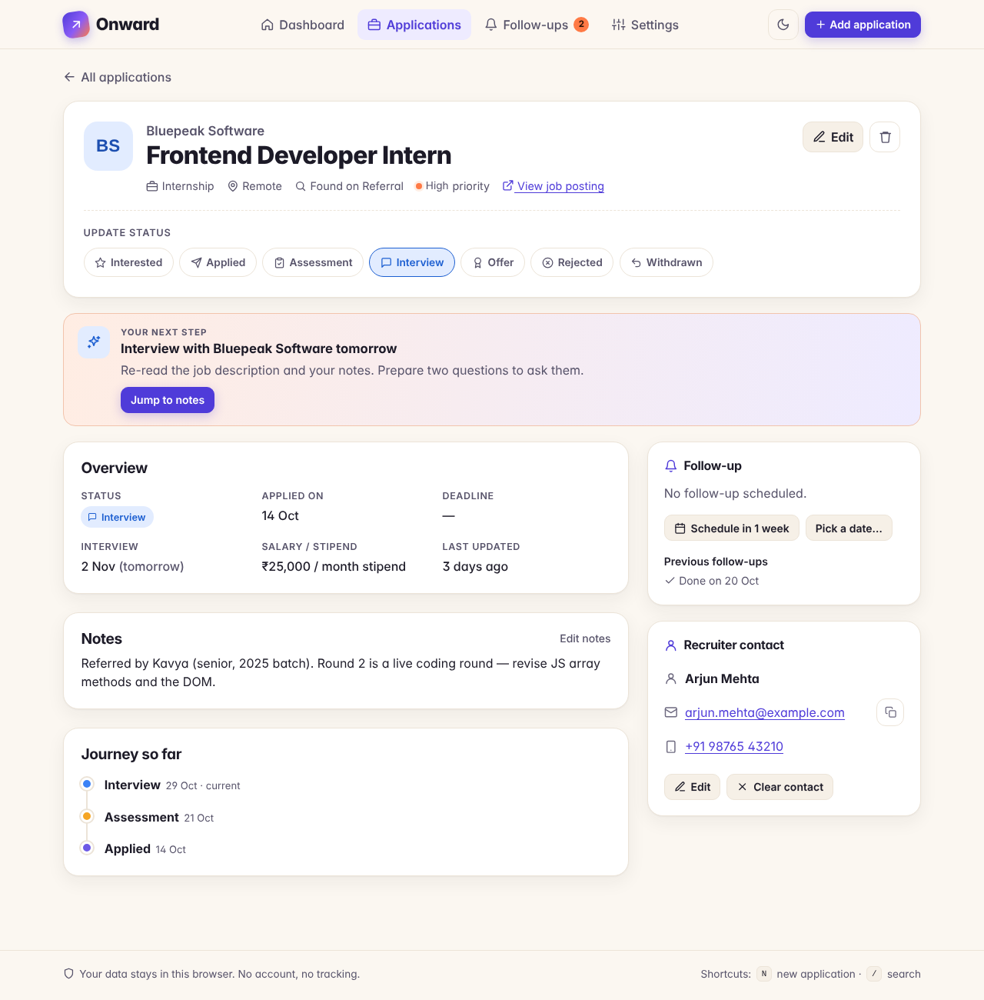
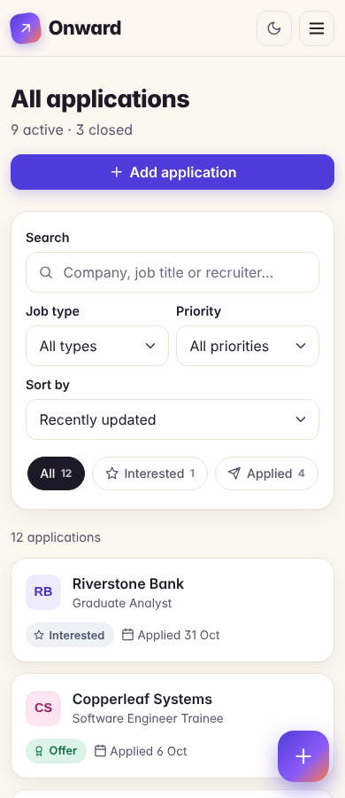
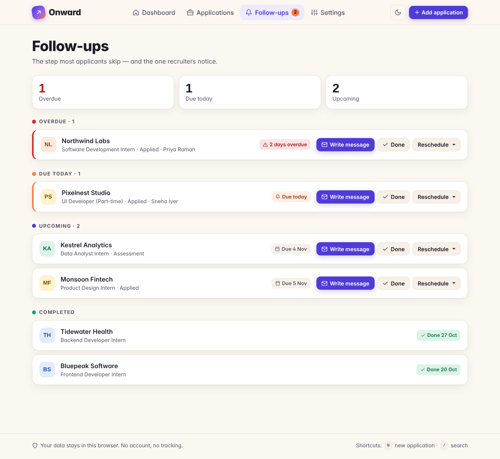
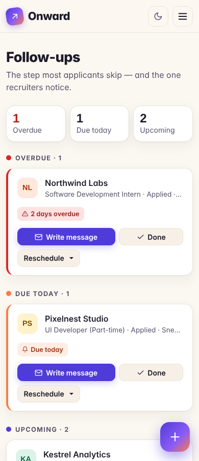
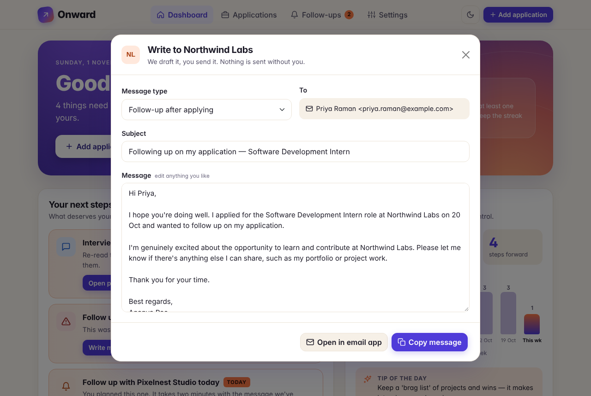
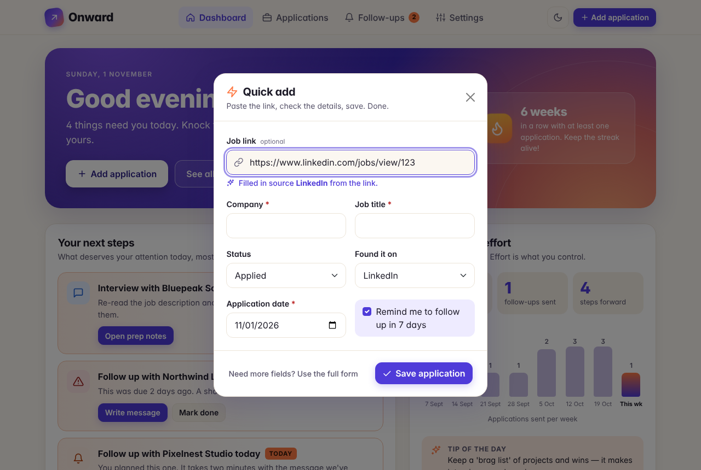
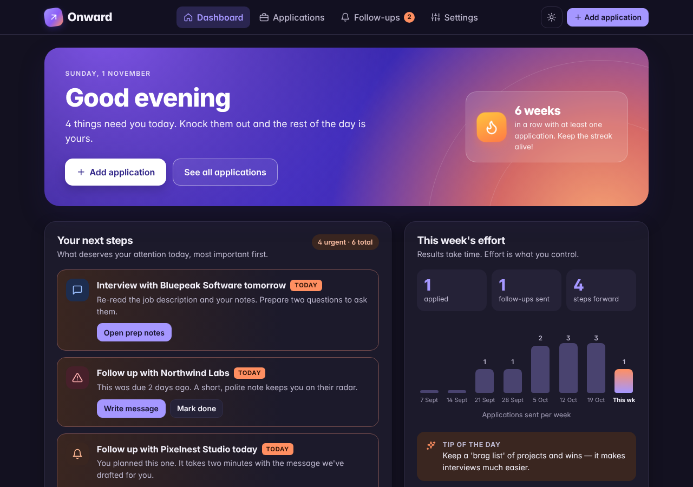

# Onward — the job tracker that tells you what to do next

> **PST_PD_044 · Personal Job Application Tracker**
> A personal job and internship tracker for students in placement season. It doesn't just store your applications — it **tells you what to do next**, **drafts your follow-up messages**, and **celebrates your effort**, not only your results.

**Live demo:** `https://<your-github-username>.github.io/<repo-name>/` *(update after deploying)*



---

## Why Onward?

Most students track applications in a spreadsheet, or don't track them at all. A spreadsheet can **store** information, but it can't tell you that a follow-up is overdue, help you write the email, or notice which of your sources actually gets replies.

| | Spreadsheet | Typical job tracker | **Onward** |
|---|---|---|---|
| Stores applications | ✅ | ✅ | ✅ |
| Tells you what to do today, ranked | ❌ | Partly (reminders) | ✅ **"Your next steps"** coach |
| Drafts follow-up / thank-you / offer emails | ❌ | Some, often paid AI | ✅ 4 templates, personalised, free |
| Fills company, title + source from a pasted link | ❌ | Via a browser extension | ✅ Built in |
| Shows which source works best for *you* | Manual formulas | Rare | ✅ "What's working" |
| Celebrates effort, gentle on rejection | ❌ | ❌ | ✅ Streaks, kind words, confetti |
| Sign-up needed | No | Yes | **No** — opens in 2 seconds |
| Your data leaves your device | Depends | Yes (their servers) | **Never** (localStorage) |
| Built for Indian campus & off-campus hiring | ❌ | ❌ | ✅ Campus drives, Internshala, Naukri, Unstop, referrals |

## Features

### Must-have (PRD 6.1) — all done
- **Dashboard:** total applications, counts by status, upcoming and overdue follow-ups, recently updated, quick add. Every number is calculated from the records.
- **Application management:** add, view, edit, delete (with confirmation), status updates, notes, job link, dates.
- **7 statuses:** Interested, Applied, Assessment, Interview, Offer, Rejected, Withdrawn. Change them from the details screen with one click.
- **Follow-ups:** schedule, see upcoming and overdue, mark complete, reschedule (+3 days, +1 week, or pick a date), with an empty state.
- **Recruiter contacts:** name, email, phone on each application. Edit or clear them.
- **Search, filter, sort:** search company, job title and recruiter. Filter by status, job type and priority. Sort by updated date, applied date, company or follow-up date.
- **localStorage persistence:** sample data on first launch, validation of saved data, graceful handling of damaged data or storage errors.
- **Responsive Bootstrap 5 layout:** table on laptops, cards on phones, collapsible navigation, floating add button on phones.

### Good-to-have (PRD 6.2) — done
- CSV export · JSON backup and restore (validated) · status history timeline · interview date · dark mode · charts (CSS-only, no library)

### ★ Onward's own features (the differentiators)
1. **"Your next steps" coach.** Ranks what needs you today: interviews in the next 3 days, overdue follow-ups, follow-ups due today, close deadlines, offers awaiting a reply, and applications with no reply for 10+ days. Each step has a one-click action.
2. **Message composer.** Drafts a polite follow-up, next-steps, thank-you or offer-reply email with the recruiter's name, role, company, date and *your* name. Copy it, or open it in your email app. Onward never sends anything itself.
3. **Smart paste.** Paste a job link and Onward fills in the company (from `careers.zoho.com`, `boards.greenhouse.io/razorpay`, …) and the source (LinkedIn, Internshala, Naukri, Unstop). Internshala and LinkedIn links that name the role also fill in the company and job title.
4. **Effort over outcomes.** A weekly effort panel (applied, follow-ups sent, steps forward), an 8-week chart, a weekly streak and a tip of the day.
5. **What's working.** Shows how often applications from each source reached an assessment, interview or offer, and names your best source.
6. **Emotional design.** Confetti for offers. A kind, encouraging message for rejections. Copy written like a supportive senior, not a corporate tool.
7. **Privacy by design.** No account and no server. Data never leaves the browser.

## Screenshots

| Laptop | Phone |
|---|---|
|  |  |
|  |  |
|  |  |
|  |  |
|  | |

## Run it locally

No installation or build step is needed.

1. Download or clone this repository.
2. Open the folder in **VS Code** and install the **Live Server** extension.
3. Right-click `index.html` and choose **Open with Live Server**.

You can also double-click `index.html` to open it directly in a browser. An internet connection is needed for Bootstrap and the fonts, which load from a CDN.

**Deploy:** push to GitHub, then go to **Settings → Pages → Deploy from a branch → `main` / root**.

## Tech stack

| Technology | Used for |
|---|---|
| HTML5 | Semantic page structure, forms, landmarks |
| CSS3 | Design tokens (CSS variables), dark mode, CSS-only charts, animations |
| Bootstrap 5.3 | Grid, navbar, modals, dropdowns, toasts, forms, tables |
| Vanilla JavaScript | CRUD, validation, dates, filters, analytics, coach rules |
| localStorage + JSON | Saving and loading data in the browser |
| Git + GitHub Pages | Version control and deployment |

There are no frameworks and no build tools. Icons are inline SVG, so no icon library is needed.

## Project structure

```
├── index.html              Dashboard
├── applications.html       All applications (search, filter, sort)
├── form.html               Add / edit (form.html?id=APP-1001 to edit)
├── details.html            One application (details.html?id=APP-1001)
├── follow-ups.html         Overdue, due today, upcoming, completed
├── settings.html           Name, reminders, theme, export, backup, reset
├── css/style.css           All custom styling + design tokens
├── js/
│   ├── utils.js            Dates, ids, escaping HTML, validation helpers
│   ├── icons.js            Inline SVG icons
│   ├── storage.js          Data model + localStorage load/save/validate
│   ├── sample-data.js      Demo records (dates relative to today)
│   ├── applications.js     Create / update / delete / status / follow-up logic
│   ├── follow-ups.js       Follow-up date rules
│   ├── coach.js            ★ Next-step rules + message templates
│   ├── analytics.js        Dashboard numbers, momentum, source insights
│   ├── filters.js          Search, filter, sort
│   ├── ui.js               Shared UI: navbar, toasts, dialogs, quick add, composer
│   └── pages/              One small script per page
├── data/sample-applications.json   Example records
├── assets/                 Favicon + screenshots
└── docs/                   Test results + viva guide
```

**Architecture.** Logic files (`applications.js`, `follow-ups.js`, `coach.js`, `analytics.js`, `filters.js`) never touch the page. They take the applications array and return new data. Page scripts draw the HTML. Every change goes through one function, `commit()` in `ui.js`, which saves, then redraws the navbar and the page. This keeps the dashboard numbers consistent everywhere.

## Statuses and follow-up rules

| Status | Meaning |
|---|---|
| Interested | Saved, not applied yet |
| Applied | Application sent |
| Assessment | Online test or assignment |
| Interview | Interviewing |
| Offer | Offer received |
| Rejected | Not selected (closed) |
| Withdrawn | You stepped back (closed) |

**Follow-up rules (PRD 10.6):**
- **Upcoming:** the date is today or later, and the follow-up isn't completed.
- **Overdue:** the date is before today, and the follow-up isn't completed.
- **Completed:** you marked it done. It's then kept in the follow-up history.
- Rejected and Withdrawn applications are hidden from active follow-ups.
- Dates are stored as `YYYY-MM-DD` using the **local** calendar. This avoids the UTC bug, where `toISOString()` gives yesterday's date in India before 5:30 AM.

## Sample data

On first launch, Onward loads 12 fictional applications (see `data/sample-applications.json`). Their dates are **relative to today**, so the demo always shows an overdue follow-up, one due today, an interview tomorrow and a deadline in 2 days. All companies, people and emails are fictional. You can reset them any time from **Settings → Reset demo data**.

## Testing

All 12 PRD test cases and the critical-path checklist pass, plus extra tests for validation, damaged data, security and phone layouts (60 checks in total). See **[docs/TESTING.md](docs/TESTING.md)**.

## Known limitations

- Data is stored in this browser only and doesn't sync between devices.
- Clearing browser data removes your applications. Use **Download backup** regularly.
- Reminders show inside the app. There are no email or push notifications.
- Onward doesn't find jobs or submit applications.
- There are no user accounts, so it isn't meant for shared computers.

## Future improvements

- Browser notifications for follow-ups due today
- A calendar view of follow-ups and interviews
- Interview prep checklists per round (aptitude, technical, HR)
- Optional cloud sync with sign-in (a separate phase with a backend)
- A Python script that reads the CSV export and creates a weekly job-search report

## Team

| Member | Contributions |
|---|---|
| Srihitha Golla (PST-26-0267) | *fill in* |
| Nihitha Rajesh (PST-26-0134) | *fill in* |
